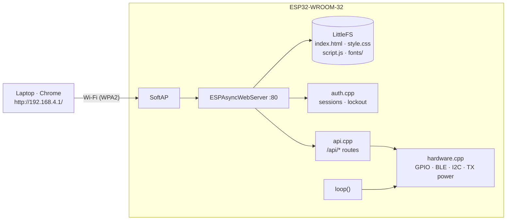

<div align="center">

# JARVIS Command Center

**A retro green-terminal command center that an ESP32 serves from its own Wi-Fi network.**

`LOGIN → ACCESS GRANTED → ESP32 BOOT ANIMATION → COMMAND CENTER`


<sub>Rendered in Chrome against a simulated API (sample data, an extra example `RELAY_1` row, fake MAC). Not a hardware capture.</sub>

</div>

## What is this?

JARVIS Command Center turns a plain **ESP32-WROOM-32** board into a self-contained web dashboard. The board
creates its own Wi-Fi access point and serves a single-page app from its flash memory. You join that network
from a laptop, open `http://192.168.4.1/`, log in, and watch the device's status or switch a few hardware
features that **you** explicitly list in the configuration.

There is no internet, router or cloud involved, and nothing is loaded from external servers.

**Why it exists.** It started as a hands-on way to learn how an ESP32 can host a real web app — LittleFS,
an async web server, session-cookie authentication and a hand-built JSON API — wrapped in a retro terminal
UI instead of a generic dashboard. It is shared so other students and makers can read it, build it and
change it.

> **Not production security.** This is a hobby project: plain HTTP, credentials compiled into the firmware.
> See [SECURITY.md](SECURITY.md) before using it for anything that matters.

## Features and honest status

| Feature | What it does | Status |
|---|---|---|
| Wi-Fi access point | Board hosts its own WPA2 network | Firmware flash + AP reported working by the author |
| Login + sessions | Credentials checked in firmware; HttpOnly cookie; per-IP lockout | UI verified against a mock API; hardware not independently confirmed |
| Boot animation | SVG ESP32 board draws itself; log shows real device values | UI verified against a mock API |
| System info | Uptime, chip, cores, CPU, flash, heap, filesystem, firmware | Implemented; mock-tested UI |
| Wi-Fi panel | SSID, IP, channel, clients, TX-power LOW/MED/HIGH | Implemented; **untested on hardware** |
| Bluetooth | BLE advertising on/off (Classic Bluetooth *not* implemented) | Implemented; **untested on hardware** |
| GPIO | Outputs/inputs only for pins you list in `include/config.h` | Implemented; **untested on hardware** |
| I2C scanner | Scans SDA 21 / SCL 22 | Implemented; **untested on hardware** |
| Reboot / logout | Two-step reboot, logout | Implemented; **untested on hardware** |
| `SLOT_A` / `SLOT_B` | Empty module placeholders in the dashboard | Placeholder only — not functional |

Per-feature detail: [docs/FEATURES.md](docs/FEATURES.md). If something behaves differently on your board,
please open an issue with a redacted serial log.

## Requirements

| Hardware | Software |
|---|---|
| ESP32-WROOM-32 dev board (PlatformIO board `esp32dev`) | Windows laptop with Wi-Fi |
| USB **data** cable | [Visual Studio Code](https://code.visualstudio.com/) + PlatformIO IDE extension |
| *(optional)* LED + resistor, I2C device | Google Chrome |

Libraries (`AsyncTCP`, `ESPAsyncWebServer`) are downloaded automatically by PlatformIO.

## Quick start (Windows + PlatformIO)

Full beginner walkthrough with expected output: **[docs/INSTALLATION.md](docs/INSTALLATION.md)**.

1. **Install** VS Code, then the *PlatformIO IDE* extension. Install the USB-serial driver if Windows shows no COM port.
2. **Open** this folder in VS Code (*File → Open Folder*, the one that contains `platformio.ini`).
3. **Create your private credentials** — the repository ships only a template:
   ```bat
   copy include\secrets.example.h include\secrets.h
   ```
   Edit `include/secrets.h` and set your own Wi-Fi name/password and dashboard login. It is git-ignored; never commit it.
4. **Select the board / port.** The board is already set (`esp32dev`). PlatformIO normally auto-detects the COM port;
   list ports with `pio device list` and, if needed, add `upload_port = COM5` (your port) to `platformio.ini`.
5. **Build, then flash the firmware** (hold the board's **BOOT** button if it hangs at `Connecting....`):
   ```bat
   pio run
   pio run -t upload
   ```
6. **Build and upload the filesystem image** (the web page in `data/`). Close the serial monitor first:
   ```bat
   pio run -t buildfs
   pio run -t uploadfs
   ```
   > Firmware and filesystem are **two separate uploads**. Both are needed at least once. Re-upload the
   > filesystem whenever you change anything in `data/`.
7. **Open the serial monitor** and press the board's **EN** button:
   ```bat
   pio device monitor
   ```
   You should see `[FS] LittleFS mounted`, `[WIFI] AP "..." up` and `[SYS] READY`.
8. **Connect** your laptop to the Wi-Fi network you set in `secrets.h` (Windows may say "no internet" — stay connected).
9. **Browse** to **`http://192.168.4.1/`** (type `http://`; there is no HTTPS) and log in.

## Using the dashboard

1. **Log in** with the username/password from your `secrets.h`. Wrong password → `ACCESS DENIED`; five misses → a temporary lock.
2. After **ACCESS GRANTED** and the boot animation you land on the command center (it refreshes every 2 s).
3. Panels, top to bottom: `sysinfo`, `wifi --status` (+ TX power), `bluetooth`, `gpio --outputs/--inputs`, `i2c --scan`, `reboot` / `logout`.
4. **GPIO:** only pins listed in `include/config.h` appear. Click `[ON]` / `[OFF]`; `LEVEL` is the real pin state read back from the chip.
5. **Reboot** asks `[y]` then `[y] CONFIRM`. After a reboot you must log in again (sessions live in RAM).

## How it fits together



More in [docs/ARCHITECTURE.md](docs/ARCHITECTURE.md).

## Project layout

```text
platformio.ini        board, libraries, partition table, LittleFS
include/              config.h (pins, limits) · secrets.example.h (template)
src/                  main · api · auth · hardware (C++ firmware)
data/                 index.html · style.css · script.js · fonts/   → LittleFS image
docs/                 guides, screenshots, styled PDF edition
tools/                mock-server.js (run the UI in a browser without hardware)
third_party/          font license texts
```

## Documentation

| Guide | Contents |
|---|---|
| [INSTALLATION](docs/INSTALLATION.md) | Complete setup and flashing guide |
| [FEATURES](docs/FEATURES.md) | Every feature and its verification status |
| [HARDWARE](docs/HARDWARE.md) | Board, pins, restrictions, wiring |
| [ARCHITECTURE](docs/ARCHITECTURE.md) | Firmware, web server, filesystem, UI, HTTP API |
| [DEVELOPMENT](docs/DEVELOPMENT.md) | Build process, extending the project, mock server |
| [TROUBLESHOOTING](docs/TROUBLESHOOTING.md) | Common errors and fixes |
| [SECURITY](SECURITY.md) | Security model, limitations, reporting vulnerabilities |
| [PDF edition](docs/JARVIS_Documentation.pdf) | Notebook-style overview of all of the above |

## Troubleshooting (short)

| Symptom | First thing to try |
|---|---|
| Page says "filesystem not mounted" | Run **Upload Filesystem Image**, then press **EN** |
| `Failed to connect to ESP32` | Hold **BOOT**, use a data cable, close the serial monitor |
| Wrong/unknown COM port | `pio device list`; set `upload_port` |
| Can't see the Wi-Fi network | Look for `softAP FAILED` in serial (password must be 8–63 chars) |
| Page unreachable | Join the ESP32 network and type `http://192.168.4.1/` |
| `secrets.h: No such file` | `copy include\secrets.example.h include\secrets.h` |

Everything else: [docs/TROUBLESHOOTING.md](docs/TROUBLESHOOTING.md).

## Status and roadmap

**Known limitations** — desktop layout only; no HTTPS; credentials compiled into firmware; Classic Bluetooth
unused and BLE is advertising-only; no OTA updates (`huge_app.csv` has no OTA slots); `platform` is not
version-pinned; hardware actions not yet verified on real boards.

**Ideas, not implemented** — HTTPS or a change-password flow stored in NVS; a BLE GATT service; sensor modules
for the empty slots; pinned library/platform versions after hardware verification; a compile-time guard against
placeholder credentials.

See [CHANGELOG.md](CHANGELOG.md).

## Contributing

Bug reports, ideas and pull requests are welcome — read [CONTRIBUTING.md](CONTRIBUTING.md) and the
[Code of Conduct](CODE_OF_CONDUCT.md). Please never post real Wi-Fi details, passwords or personal paths.

## License

**No license has been selected yet**, so by default all rights are reserved. A proposed MIT license is
included as `LICENSE.PROPOSED-MIT.txt`, awaiting the owner's confirmation (see
[docs/PUBLISHING.md](docs/PUBLISHING.md)). Bundled fonts keep their own licenses — see
[THIRD_PARTY_NOTICES.md](THIRD_PARTY_NOTICES.md).

## Credits

**Built by ADITECHSMITH** · Instagram: [@aditechsmith](https://www.instagram.com/aditechsmith?obrf=MXZlOWpub2k2M3RrbQ==)

Explore it, learn from it, break it, improve it — contributions are invited.
